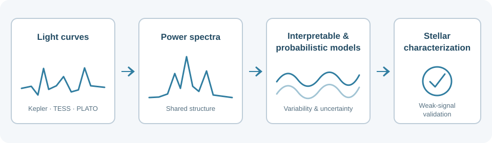

## Research Overview

My research lies at the intersection of astrophysics, machine learning, and statistical inference. I develop data-driven methods to extract physical information from complex astronomical observations, with particular attention to uncertainty, interpretability, and the reliable recovery of weak signals. My work began with neural-network reconstruction and Bayesian inference in cosmology and has expanded into precision stellar spectroscopy, exoplanet detection, and the characterization of stellar variability. Across these applications, I combine neural networks, evolutionary optimization, probabilistic generative models, and physically informed validation, with an emphasis on reproducible, open-source scientific software.

**Further information:** [Publications](/full_papers/) · [Scientific Software](/code/) · [Presentations](/full_presentations/) · [CV](/cv/)

## Stellar Variability and Exoplanet Detection

How can we distinguish the tiny Doppler signature of a planet from changes in a star's spectrum? During my postdoctoral work at the University of Geneva, I developed deep-learning methods to infer Doppler shifts directly from high-resolution stellar spectra. The approach uses physically motivated spectral representations and controlled planetary-signal injection–recovery experiments to assess what can actually be detected in real observations. This work led to [*doppleriann*](/code/#doppleriann) and a [lead-author study in *Astronomy & Astrophysics* (2026)](https://doi.org/10.1051/0004-6361/202659375), complementing [collaborative work on stellar-activity mitigation (Zhao et al., 2024)](https://doi.org/10.1051/0004-6361/202450022).

{: .mx-auto.d-block :}
*Injection–recovery test in HARPS-N solar spectra: the periodogram of deep-learning Doppler-shift estimates reveals an injected 100-day signal that is less apparent in conventional radial velocities ([Gómez-Vargas et al., 2026](https://doi.org/10.1051/0004-6361/202659375)).*

Beyond measuring Doppler shifts, my current work asks what stellar variability can tell us about a star's physical state, and how to describe that variability without mistaking it for a planetary signal. I investigate interpretable, data-driven models of stellar power spectra, including symbolic regression, alongside probabilistic generative models for heterogeneous stellar light curves. These approaches aim to identify shared patterns while retaining differences between stars and observing conditions, with applications to Kepler, TESS, and the forthcoming PLATO mission. Preliminary work on residual structure in stellar backgrounds was [presented at TASC10/KASC17 (2026)](https://doi.org/10.5281/zenodo.21281645).

{: .mx-auto.d-block :}
*Research direction: use photometric light curves and their power spectra to build interpretable, uncertainty-aware descriptions of stellar variability; connect these descriptions to the validation of weak signals.*

This work extends my earlier experience with uncertainty-aware inference and generative models into stellar astrophysics. A longer-term goal is to relate photometric variability to spectroscopic activity indicators, improving both stellar characterization and exoplanet searches. I also contribute deep-learning and generative-modelling expertise to the [SpeckleNet collaboration on high-contrast exoplanet imaging](https://meetingorganizer.copernicus.org/EPSC-DPS2025/EPSC-DPS2025-2087.html). Together, these activities connect stellar characterization with the validation of weak planetary signals across complementary observing techniques.

## Astrophysical Statistical Inference

Another strand of my research develops flexible and computationally efficient methods for reconstructing observables and inferring physical parameters from astronomical data. Much of this work began in cosmology, but the underlying questions—how to use small datasets, quantify uncertainty, and accelerate expensive inference—also guide my work in stellar astrophysics.

I developed neural-network reconstructions of the Hubble parameter, growth rate, and supernova distance modulus, including uncertainty estimates from Monte Carlo dropout ([Gómez-Vargas et al., 2023, *EPJC*](https://doi.org/10.1140/epjc/s10052-023-11435-9)). I then created [*nnogada*](/code/#nnogada), which uses genetic algorithms to optimize neural-network architectures ([Gómez-Vargas et al., 2023, *PRD*](https://doi.org/10.1103/PhysRevD.107.043509)). Related co-led studies apply data-driven reconstruction to [Rubin Observatory supernova simulations](/full_papers/#led-and-co-led) and [galaxy rotation curves](/full_papers/#led-and-co-led); implementations are collected under [ANN Reconstructions](/code/#ann-reconstructions).

{: .mx-auto.d-block :}
*Architecture optimization with genetic algorithms provides a systematic way to select neural networks for precision reconstruction and inference ([Gómez-Vargas et al., 2023](https://doi.org/10.1103/PhysRevD.107.043509)).*

For Bayesian parameter estimation, I contributed sampling and convergence tools to [*SimpleMC*](/code/#simplemc) and developed [*neuralike*](/code/#neuralike), which uses neural-network surrogates to accelerate expensive likelihood evaluations ([Gómez-Vargas & Vázquez, 2024, *PRD*](https://doi.org/10.1103/PhysRevD.110.083518)). My collaborative work includes analyses of dark-energy models and the [CosmoVerse White Paper](/full_papers/#collaborative), as well as machine-learning studies of dark-matter halos and generative modelling of N-body simulations with [*NCosmoVAE*](/code/#ncosmovae). These experiences inform my ongoing development of probabilistic methods for stellar data.

**Further information:** [Publications](/full_papers/) · [Scientific Software](/code/) · [Presentations](/full_presentations/) · [CV](/cv/)
