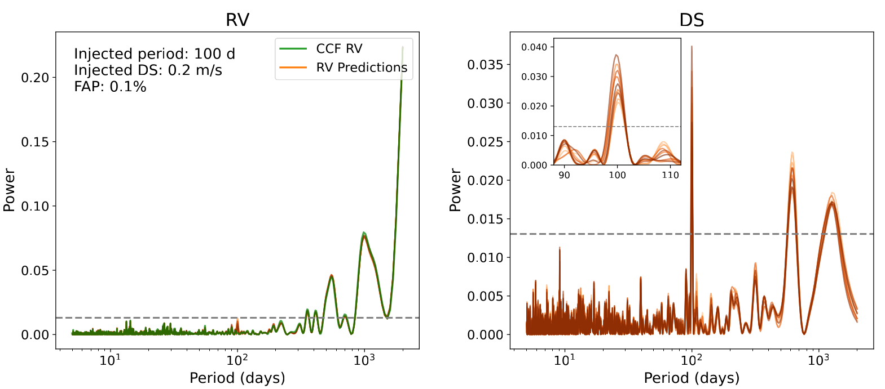
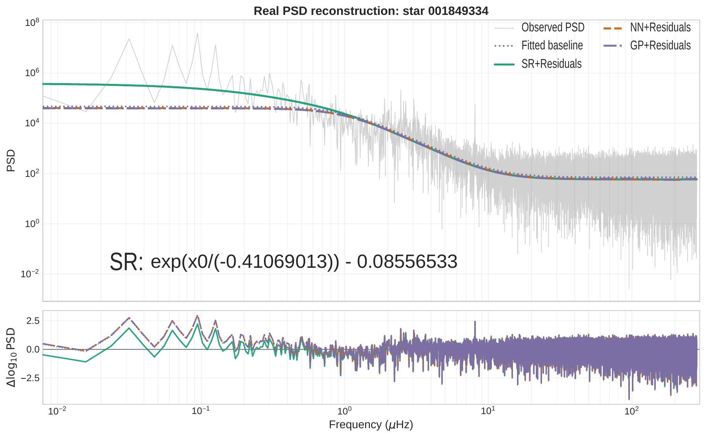
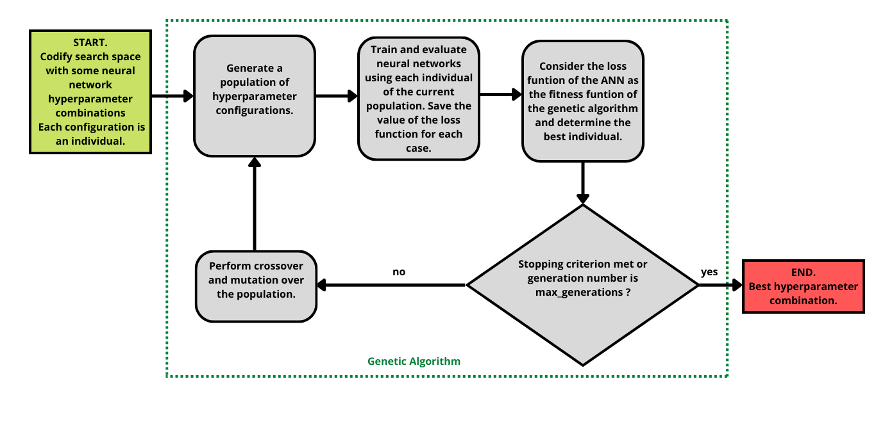
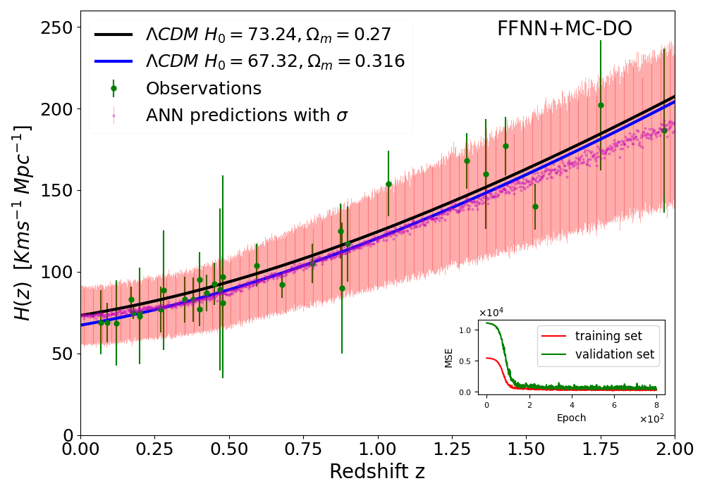
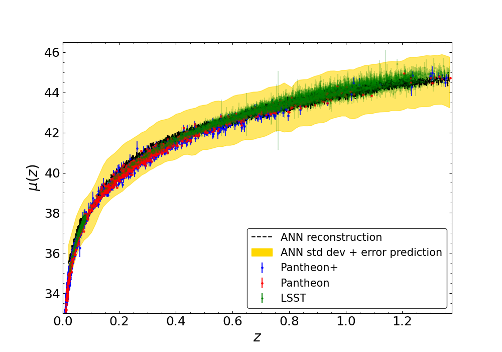

## Research Overview

My research lies at the intersection of astrophysics, machine learning, and statistical inference. I develop data-driven methods to extract physical information from complex astronomical observations, with particular attention to uncertainty, interpretability, and the reliable recovery of weak signals. My work began with neural-network reconstruction and Bayesian inference in cosmology and has expanded into precision stellar spectroscopy, exoplanet detection, and the characterization of stellar variability. Across these applications, I combine neural networks, evolutionary optimization, probabilistic generative models, and physically informed validation, with an emphasis on reproducible, open-source scientific software.

**Further information:** [Publications](/full_papers/) · [Scientific Software](/code/) · [Presentations](/full_presentations/) · [CV](/cv/)

## Stellar Variability and Exoplanet Detection

During my postdoctoral work at the University of Geneva, I developed deep-learning methods to infer Doppler shifts directly from high-resolution stellar spectra. The approach uses physically motivated spectral representations and controlled planetary-signal injection–recovery experiments to assess what can actually be detected in real observations. This work led to [*doppleriann*](/code/#doppleriann) and a [lead-author study in *Astronomy & Astrophysics* (2026)](https://doi.org/10.1051/0004-6361/202659375), complementing [collaborative work on stellar-activity mitigation (Zhao et al., 2024)](https://doi.org/10.1051/0004-6361/202450022).

{: .mx-auto.d-block :}

*Injection–recovery test in HARPS-N solar spectra: the periodogram of deep-learning Doppler-shift estimates reveals an injected 100-day signal that is less apparent in conventional radial velocities ([Gómez-Vargas et al., 2026](https://doi.org/10.1051/0004-6361/202659375)).*

As an MSCA-COFUND ALLIES fellow at IAA-CSIC, with a joint affiliation at ICE-CSIC, I investigate what stellar variability reveals about a star's physical state and how best to describe it. I use symbolic regression to develop interpretable models of stellar power spectra in the frequency domain, alongside probabilistic generative models of heterogeneous light curves in the time domain. These approaches aim to identify shared patterns while retaining differences between stars and observing conditions, with applications to Kepler, TESS, and the forthcoming PLATO mission. I [presented preliminary work on residual structure in stellar backgrounds at TASC10/KASC17 (2026)](https://doi.org/10.5281/zenodo.21281645); a manuscript is in preparation for submission in November 2026.

{: .mx-auto.d-block :}

*Stellar power-spectrum reconstruction using symbolic regression (SR), with neural-network (NN) and Gaussian-process (GP) residual models for comparison. The lower panel shows the residuals in log power. Figure from my [TASC10/KASC17 poster (2026)](https://doi.org/10.5281/zenodo.21281645).*

This work extends my earlier experience with uncertainty-aware inference and generative models into stellar astrophysics. A longer-term goal is to relate photometric variability to spectroscopic activity indicators, improving both stellar characterization and exoplanet searches. I also contribute deep-learning and generative-modelling expertise to the [SpeckleNet collaboration on high-contrast exoplanet imaging](https://meetingorganizer.copernicus.org/EPSC-DPS2025/EPSC-DPS2025-2087.html). Together, these activities connect stellar characterization with the validation of weak planetary signals across complementary observing techniques.

## Astrophysical Statistical Inference

Another strand of my research develops flexible and computationally efficient methods for reconstructing observables and inferring physical parameters from astronomical data. Much of this work began in cosmology during my PhD at IPN and my first postdoctoral appointment at UNAM in Mexico. The underlying questions—how to use small datasets, quantify uncertainty, and accelerate expensive inference—also guide my analysis of stellar observations.

I developed neural-network reconstructions of the Hubble parameter, growth rate, and supernova distance modulus, including uncertainty estimates from Monte Carlo dropout ([Gómez-Vargas et al., 2023, *EPJC*](https://doi.org/10.1140/epjc/s10052-023-11435-9)). I then created [*nnogada*](/code/#nnogada), which uses genetic algorithms to optimize neural-network architectures ([Gómez-Vargas et al., 2023, *PRD*](https://doi.org/10.1103/PhysRevD.107.043509)). These methods informed co-led studies of dark-energy reconstruction with [simulated Rubin Observatory supernova data (Mitra et al., 2024)](https://www.sciencedirect.com/science/article/pii/S2212686424002887) and [galaxy rotation curves (Garcia-Arroyo et al., 2026)](https://www.sciencedirect.com/science/article/pii/S2212686426000294). The implementations are collected under [ANN Reconstructions](/code/#ann-reconstructions).

{: .mx-auto.d-block :}

*Architecture optimization with genetic algorithms provides a systematic way to select neural networks for precision reconstruction and inference ([Gómez-Vargas et al., 2023](https://doi.org/10.1103/PhysRevD.107.043509)).*

  
  

*Examples of data-driven reconstructions of cosmological distance measurements and their uncertainties; see [Gómez-Vargas et al. (2023)](https://doi.org/10.1140/epjc/s10052-023-11435-9) and [Mitra et al. (2024)](https://www.sciencedirect.com/science/article/pii/S2212686424002887).*

During a [remote research visit hosted by the Kavli Institute for Cosmology, University of Cambridge (2020)](/cv/#research-visits), I worked on Bayesian inference and nested sampling. I also contributed sampling and convergence tools to [*SimpleMC*](/code/#simplemc) and explored [genetic algorithms for cosmological parameter estimation (Medel Esquivel et al., 2023)](https://www.mdpi.com/2218-1997/10/1/11). To accelerate expensive likelihood evaluations within nested sampling, I developed [*neuralike*](/code/#neuralike), combining neural-network surrogates with genetic-algorithm optimization ([Gómez-Vargas & Vázquez, 2024, *PRD*](https://doi.org/10.1103/PhysRevD.110.083518)).

My collaborative work includes machine-learning analyses of [dark-matter halo structure (Chacón et al., 2023)](https://doi.org/10.1103/PhysRevD.107.123515) and [generative modelling of N-body simulations (Chacón-Lavanderos et al., 2026)](https://doi.org/10.1103/b6lj-rlff). I have also contributed Bayesian analyses of cosmological models and observational constraints ([Vázquez et al., 2024](https://doi.org/10.1103/PhysRevD.109.023511); [Garcia-Salcedo et al., 2024](https://www.mdpi.com/2218-1997/10/9/353); [Tamayo et al., 2025, *Physics of the Dark Universe*](https://doi.org/10.1016/j.dark.2025.101901); [Chaudhary et al., 2026](https://doi.org/10.1140/epjc/s10052-026-15806-w)) and to discussions of nonparametric reconstruction and metaheuristic algorithms in the [CosmoVerse White Paper (2025)](https://www.sciencedirect.com/science/article/pii/S221268642500158X). Together, these projects have strengthened my experience with probabilistic methods for small and complex datasets, which I now apply to stellar observations.
